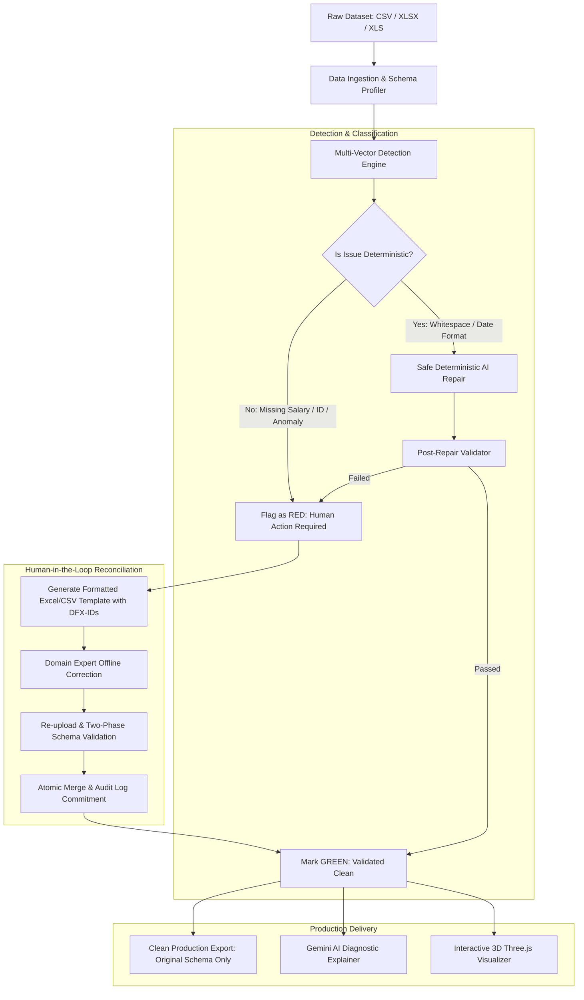

# 🛡️ RECODA — Autonomous Data Quality & Repair Engine

<div align="center">


<p align="center">
  <b>Autonomous Data Quality Profiling • Deterministic Safe Repair • Human-in-the-Loop Reconciliation</b>
  <br />
  <i>Engineered for enterprise data pipelines, analytical databases, and machine learning integrity.</i>
</p>

[Key Features](#-key-features) • [Architecture](#-system-architecture) • [Quick Start](#-quick-start) • [Reconciliation Workflow](#-human-in-the-loop-reconciliation) • [API Documentation](#-api-endpoints) • [Testing](#-automated-testing)

</div>

---

## 📌 Executive Summary

Modern enterprise analytics, reporting dashboards, and machine learning models fail silently when fed corrupt, unstandardized, or ambiguous data. Conventional AI repair tools often err by **hallucinating or guessing missing facts** (such as salaries, identification numbers, or birthdates), introducing catastrophic data corruption.

**RECODA (DataFix)** solves this fundamentally through a **strict dual-tier governance engine**:
1. **Deterministic Autonomous Repair (GREEN):** Safely and automatically corrects deterministic issues (whitespace padding, ISO date standardization, case normalization) where the intent is mathematically and syntactically unambiguous.
2. **Human-in-the-Loop Reconciliation (RED):** Identifies missing business facts, statistical anomalies, and conflicting records, generates offline-editable reconciliation templates with immutable serial identifiers (`DFX-XXXXXX`), validates human edits before merging, and maintains an irreversible audit log.

> 🔒 **Core Engineering Principle:** AI must repair only what it can reliably and deterministically infer. **It must never fabricate business reality.**

---

## 🌟 Key Features

| Capability | Description |
| :--- | :--- |
| **🟢 Strict Dual-Class Routing (GREEN / RED)** | Every record is categorized instantaneously into either verified clean/auto-repaired (`GREEN`) or requiring human decision (`RED`). |
| **🔍 Multi-Vector Anomaly Detection** | Profiles missing values, date format chaos, suspicious numeric spikes/outliers (Z-score & IQR), whitespace anomalies, and duplicate entities. |
| **🧩 Human-in-the-Loop Excel Workflow** | One-click export of RED records into formatted Excel/CSV templates with persistent serial keys. Teams can edit offline and upload back for automated validation and merge. |
| **🌐 Interactive 3D Health Sphere** | Powered by Three.js — visualizes your dataset as a real-time 3D point cloud where spatial density and particle colors reflect dataset hygiene and anomaly clusters. |
| **🤖 Gemini AI Executive Insights** | Optional integration with Google Gemini AI to generate natural-language root-cause diagnostics, executive summaries, and systemic pipeline recommendations. |
| **🧼 Clean Zero-Pollution Export** | Exported datasets retain the exact original column schema. No internal metadata, flags, or tracking IDs pollute your downstream tables. |
| **📜 Full Audit Trail & Reproducibility** | Every repair, rule execution, and human patch is logged into SQLite with timestamps, source column names, before/after values, and user attributions. |

---

## 🏗️ System Architecture



---

## 📁 Repository Structure

```plaintext
RECODA/
├── DataFix/
│   ├── backend/
│   │   ├── app/
│   │   │   ├── api/
│   │   │   │   └── endpoints.py         # RESTful FastAPI routes
│   │   │   ├── models/
│   │   │   │   └── db.py                # SQLite database models & audit trail
│   │   │   ├── schemas/
│   │   │   │   └── dataset.py           # Pydantic validation schemas
│   │   │   ├── services/
│   │   │   │   ├── ai_explainer.py      # Google Gemini AI diagnostic generator
│   │   │   │   ├── detectors.py         # Anomaly & data quality inspection rules
│   │   │   │   ├── profiling.py         # Statistical profiling & summary stats
│   │   │   │   ├── reconciliation.py    # Template generator & merge engine
│   │   │   │   └── repairs.py           # Safe deterministic repair functions
│   │   │   ├── utils/
│   │   │   │   └── helpers.py           # File handling, serialization helpers
│   │   │   └── main.py                  # FastAPI application entrypoint
│   │   ├── samples/                     # Synthetic test datasets (CSV & XLSX)
│   │   ├── tests/                       # Complete automated unit & integration tests
│   │   ├── requirements.txt             # Python dependencies
│   │   └── generate_samples.py          # Synthetic dataset generator
│   ├── frontend/
│   │   ├── css/
│   │   │   └── styles.css               # Glassmorphism dark UI styling
│   │   ├── js/
│   │   │   ├── api.js                   # Client-side API integration layer
│   │   │   ├── app.js                   # Application state, tables & UI filters
│   │   │   └── chart3d.js               # Three.js 3D data health sphere
│   │   └── index.html                   # Single-page web application
│   ├── Docs/                            # Hackathon specifications, test datasets & templates
│   ├── api_key.example.txt              # Sample configuration for Gemini API key
│   ├── run_recoda.bat                   # 1-click Windows launcher
│   ├── run_datafix.bat                  # Alternate batch launcher
│   └── run_datafix.ps1                  # PowerShell launcher script
├── .gitignore                           # Excludes secrets, uploads, databases & temp files
└── README.md                            # Project documentation
```

---

## 🚀 Quick Start

### 1. Prerequisites
- **Python 3.9+** (Check via `python --version`)
- Modern web browser (Chrome, Edge, Firefox, Brave)
- Git (already configured)

### 2. Installation

Clone the repository and enter the backend directory:
```bash
git clone https://github.com/sahu009/RECODA.git
cd RECODA/DataFix/backend
```

Install backend dependencies:
```bash
pip install -r requirements.txt
```

### 3. Configure Gemini AI (Optional)

RECODA runs **100% locally and offline** for profiling, detection, auto-repair, and reconciliation. To enable Google Gemini AI-driven diagnostic summaries:

1. Copy the example key file:
   ```bash
   copy ..\api_key.example.txt ..\api_key.txt
   ```
2. Paste your Google Gemini API key into `DataFix/api_key.txt` (or set the `GEMINI_API_KEY` environment variable).

> 🛡️ **Privacy & Security:** `api_key.txt`, SQLite databases (`*.db`), user uploads (`/uploads/`), and exported files (`/exports/`) are strictly ignored by `.gitignore` and are never committed to public repositories.

### 4. Launch Application

**Windows 1-Click Launch:**
- Double click `DataFix/run_recoda.bat`

**Or via Command Line:**
```bash
cd DataFix/backend
python -m uvicorn app.main:app --host 127.0.0.1 --port 8000 --reload
```

Open your browser at:
👉 **[http://127.0.0.1:8000](http://127.0.0.1:8000)**

---

## 🔄 Human-in-the-Loop Reconciliation

When records have critical missing values or conflicting anomalies:

1. **Review in Dashboard:** Switch to the **"Action Required (RED)"** tab to filter and inspect issues by error type.
2. **Download Correction Template:** Click **"Download Correction Template"** to get a pre-formatted Excel/CSV with:
   - All unresolved RED records.
   - An immutable tracking column: `_datafix_id` (`DFX-XXXXXX`).
   - Highlighted error notes indicating exactly what needs human correction.
3. **Edit Offline:** Team members can modify values directly in Microsoft Excel, Google Sheets, or LibreOffice.
4. **Upload Corrections:** Click **"Upload Corrected File"**. RECODA:
   - Validates column headers against the original dataset.
   - Re-checks corrected rows to verify that errors are genuinely resolved.
   - Atomically merges validated corrections into the main working dataset.
   - Automatically transitions resolved rows from **RED** to **GREEN**.
   - Records the human author, timestamp, and audit diff.

---

## 🔌 API Endpoints

FastAPI provides an automatic, interactive OpenAPI documentation interface at:
👉 **`http://127.0.0.1:8000/docs`**

| Method | Endpoint | Description |
| :--- | :--- | :--- |
| `POST` | `/api/upload` | Ingests CSV/XLSX file, initiates profiling and initial detection |
| `GET` | `/api/datasets/{id}` | Retrieves dataset health summary, GREEN/RED counts, and metrics |
| `GET` | `/api/datasets/{id}/records` | Filterable records table with pagination, search, and error filters |
| `POST` | `/api/datasets/{id}/auto-repair` | Executes deterministic safe repairs (whitespace, dates) |
| `GET` | `/api/datasets/{id}/template` | Generates formatted Excel/CSV reconciliation template for RED rows |
| `POST` | `/api/datasets/{id}/reconcile` | Uploads, validates, and merges human corrections |
| `GET` | `/api/datasets/{id}/export` | Downloads final cleaned dataset (original columns only) |
| `GET` | `/api/datasets/{id}/audit-trail` | Retrieves the immutable change log and transformation history |
| `POST` | `/api/datasets/{id}/ai-explain` | Requests Gemini AI natural language diagnosis and executive insights |

---

## 🧪 Automated Testing

RECODA includes a comprehensive test suite covering the entire pipeline:
- Ingestion and schema profiling
- Anomaly detectors and outlier isolation
- Deterministic repair idempotency
- Reconciliation template generation and merge integrity
- Clean export verification

Run tests with `unittest`:
```bash
cd DataFix/backend
python -m unittest discover tests -v
```

---

## 🛡️ Security & Privacy First

- **Zero Data Leakage:** All customer datasets and runtime caches live exclusively in local directories excluded from version control.
- **No Hallucinated Business Values:** Deterministic rules strictly guard against AI guessing numeric/categorical attributes.
- **Sanitized Exports:** Internal tracking identifiers (`_datafix_id`, `_issues`, `_human_required`) are stripped before user downloads.

---

## 👥 Hackathon & Development Credits

- **Project:** RECODA (Autonomous Data Quality & Repair Engine)
- **Author:** [Piyush Sahu](https://github.com/sahu009)
- **Club / Initiative:** INNOVEDGE Innovation & Entrepreneurship Development Club
- **License:** MIT License

---

<div align="center">
  <sub>Built with ❤️ for bulletproof data pipelines and reliable enterprise AI.</sub>
</div>
